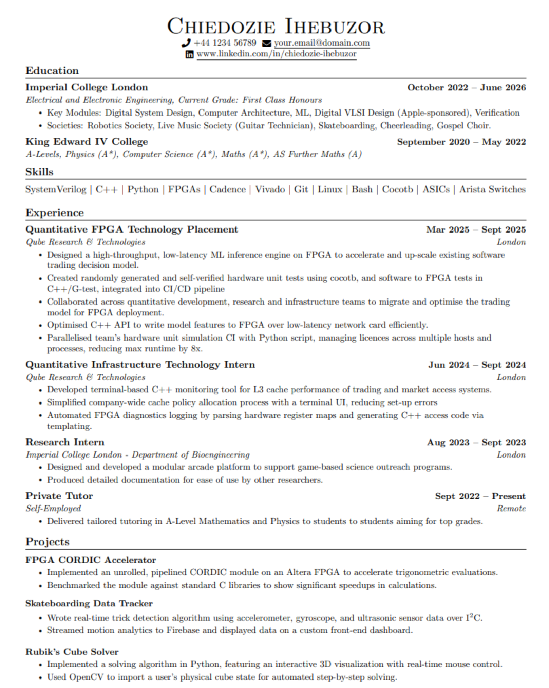

# LaTeX Resume Template

Build the CV to a PDF with `make`.

## Credit
Adapted from [JV's Resume Template](https://www.overleaf.com/latex/templates/jvs-resume-template/pqhbdhzwyvgv)

## Requirements

You need a TeX distribution that provides `pdflatex`.

Quickest: run the bundled installer, which auto-detects your OS:

```sh
./install.sh
```

Or install one manually:

- **TeX Live** (Linux / BSD) — https://tug.org/texlive/acquire-netinstall.html
- **MiKTeX** (Windows / macOS / Linux) — https://miktex.org/download
- **MacTeX** (macOS) — https://tug.org/mactex/mactex-download.html

A full install includes everything below; on a minimal install you may need to
add these LaTeX packages (MiKTeX installs them automatically on first use):

- [fontawesome5](https://ctan.org/pkg/fontawesome5)
- [titlesec](https://ctan.org/pkg/titlesec)
- [enumitem](https://ctan.org/pkg/enumitem)
- [tabularx](https://ctan.org/pkg/tabularx)
- [fancyhdr](https://ctan.org/pkg/fancyhdr)
- [multicol](https://ctan.org/pkg/multicol)
- [marvosym](https://ctan.org/pkg/marvosym)

## How it works

The resume is split into two layers:

- **`main.tex` — the template.** It owns everything visual: packages, margins,
  section styling, and the reusable render commands. You rarely need to touch it.
- **`particulars/*.tex` — the content.** Each file only defines content macros
  (personal details, skills, education, experience, projects); it does no
  formatting.

`main.tex` pulls in one particulars file with a single line near the top:

```tex
\input{particulars/hardware}
```

**Make a particulars file for each industry, field, or even company.** To target
a different role, copy an existing particulars file, edit the text, and point
`main.tex` at the new file — the layout stays consistent across all of them.

```
main.tex                 <- template (layout + sections)
particulars/             <- content (split into base/hardware/software)
Makefile                 <- builds main.tex -> resume.pdf
install.sh               <- installs the TeX requirements
preview.png              <- resume preview (shown below)
```

### Adding an entry

Each entry is one self-contained block in a particulars file. For example, an
experience entry looks like:

```tex
\resumeSubheading{Role}{Dates}{Company}{Location}
\resumeItemListStart
    \resumeItem{First bullet point.}
    \resumeItem{Second bullet point.}
\resumeItemListEnd
```

The same pattern applies to education (`\resumeSubheading`) and projects
(`\resumeProjectHeading`). There is no list of keys to keep in sync — just add
the block where you want it to appear.

## Build

```sh
make          # two pdflatex passes -> ./resume.pdf
make clean    # remove build/ and resume.pdf
```

## Sneak Peek



